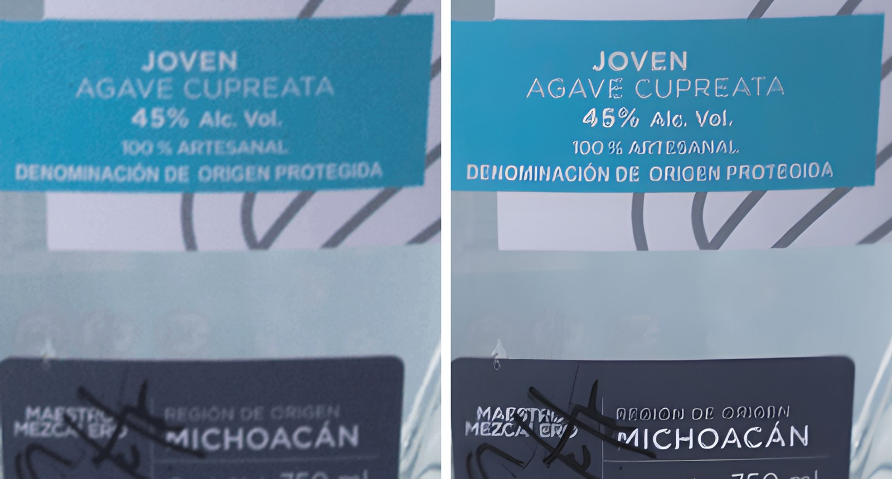

# IA para imágenes de producto: Casa VOV Inspiración

*Documento 04 · Rediseño del sitio web · Preparado el 23 de octubre de 2026*

> **Método.** Solo funcionó la búsqueda web, y casi todos los precios vienen de agregadores. **(no verificado)** = una sola fuente o fuentes en conflicto; confirmar antes de pagar. La §1 la medí sobre `Final_Version_Backup/assets/`.

---

## Resumen ejecutivo

1. **Regla de oro:** el texto de la etiqueta **nunca lo dibuja un modelo generativo**. Sale de la foto original (mejorada sin generar píxeles nuevos) o del arte vectorial aprobado, y se compone encima al final.
2. **La solución de fondo es volver a fotografiar.** El texto regulado mide entre 4 y 10 px en los PNG actuales. Ningún upscaler puede recuperar letras que no existen; solo puede inventarlas.
3. **Mejora fiel:** Topaz Gigapixel · alternativa Magnific Precision V2 · gratis Real-ESRGAN **solo para vidrio y fondo**: en la prueba real de este repo (sección 4.7) cambió "45%" por "46%" en la etiqueta.
4. **Escenas:** Nano Banana 2.1 con la etiqueta recompuesta en Photoshop · alternativas GPT Image 2.5 Sunburst o FLUX 3 Image · gratis Qwen-Image-Edit-2511.
5. **QA obligatorio:** OCR contra el texto aprobado y revisión humana al 300 %. No tergiversar el color, el tamaño ni las medallas.

---

## 1. Diagnóstico de los archivos actuales

| Archivo | Hallazgo | Consecuencia |
|---|---|---|
| `bottles/main/*.png` (5) | PNG **indexado de 256 colores** (no es RGBA real). La botella mide ≈370 px de ancho en un lienzo de 1200. "Denominación de Origen Protegida" mide ≈7–10 px de alto | El escalado amplifica la cuantización. El texto está al límite de lo legible |
| `bottles/flavored/*.png` (3) | La botella mide ≈235 px. Los textos laterales ("% Alc. Vol.", "Cont. Net. 1 L") miden ≈4–5 px: **ilegibles** | Un upscaler tendría que *inventarlos*. Hace falta foto nueva o vector |
| Todas las botellas | El vidrio es 100 % opaco (el fondo blanco del estudio quedó "horneado") y tiene halo claro | Sobre fondos oscuros, la botella se ve lechosa y pegada |
| `Procesos/*.jpeg` | 1280×720 y 961×1280, comprimidos | Sirven hasta ~800 px; para un hero hay que fotografiar de nuevo |
| `medals/Spirits_Seleccion…png` | 6000×3375 px | Bajar a 600/1200 px o pedir el SVG al certamen |

**Primero hay que pedir los originales (RAW/TIFF/PSD):** el PNG de paleta es una copia degradada.

---

## 2. Dos trabajos distintos: no mezclarlos

- **(a) Mejora fiel:** escalar, quitar ruido, enfocar, limpiar el halo y corregir la luz. Criterio: **ninguna letra, cifra ni trazo puede diferir del original.**
- **(b) Escenas:** la botella en una barra de piedra volcánica, un campo de agave al atardecer o coctelería. El fondo puede ser inventado; **la botella y su etiqueta tienen que ser las reales.**

### Por qué la IA reescribe el texto pequeño

- **Los upscalers creativos** (Magnific Creative, Topaz Bloom/Redefine/Wonder, SUPIR, Krea) generan detalle a partir de lo que "suele" haber. Ante una letra de 5 px dibujan una letra verosímil, no necesariamente la correcta: "Cupreata" puede volverse "Cuprata" y "45 %", "46 %". Un paper de 2026 armó un dataset de texto alucinado justamente con SUPIR, PASD y similares ([TGSR](https://arxiv.org/html/2610.14281v1)).
- **Los modelos de edición** (Nano Banana, GPT Image, FLUX, Seedream, Qwen) regeneran la imagen completa a través de un espacio latente comprimido, así que también redibujan lo que "no tocaron". Algunos conservan bien las etiquetas en pruebas, pero ninguno lo garantiza ([Fuser](https://fuser.studio/articles/nano-banana-vs-gpt-image)). ByteDance admite que Seedream 5.0 Pro todavía falla en texto fino y en consistencia a nivel píxel ([The Rundown](https://www.therundown.ai/tools/seedream-5-0-pro)).
- **Cómo prevenirlo:** en (a), modelos no generativos o de precisión con la creatividad en 0. En (b), máscara sobre la botella y **volver a pegar los píxeles originales de la etiqueta**, o reconstruirla desde el vector. En ambos casos, QA (§4.6). Pedir en el prompt que no cambie el texto no garantiza nada.

---

## 3. Herramientas vigentes (octubre de 2026)

### 3.1 Mejora fiel (a)

| Herramienta | Modo seguro para texto | Resolución máx. | Precio aprox. | Uso comercial / API |
|---|---|---|---|---|
| **Topaz Gigapixel** | Standard, High Fidelity y *Text & Shapes*. Evitar Recover, Redefine y Wonder (son generativos) | 256 MP en la nube ([docs](https://docs.topazlabs.com/gigapixel-ai/filters-panel/generative-models)) | Personal US$19/mes, Pro US$54/mes; solo suscripción ([Topaz](https://www.topazlabs.com/pricing)) | Sí · escritorio; API (no verificado) |
| **Topaz Photo** (antes Photo AI) | Denoise, Sharpen, Upscale High Fidelity v3 ([notas](https://docs.topazlabs.com/topaz-photo/release-summary)) | n/d | ≈US$199/año (no verificado) | Sí · escritorio |
| **Magnific Precision V2** (antes Freepik) | *Precision* es fiel; **Creative inventa** | Hasta 16× (no verificado) | Créditos; Premium ≈US$20/mes (no verificado) ([Oakgen](https://oakgen.ai/blog/magnific-ai-freepik-rebrand-pricing)) | Sí · [API](https://docs.magnific.com/api-reference/image-upscaler-precision-v2) |
| **Photoshop › Generative Upscale** | Firefly Upscaler y Gigapixel son fieles; **Bloom es creativo** | Firefly 6144²; Gigapixel ≈56 MP | Gigapixel 10 créditos (hasta 25 MP); Bloom 35 ([Adobe](https://helpx.adobe.com/lightroom/desktop/kb/generative-upscale-topaz-gigapixel-faq.html), [PS Essentials](https://www.photoshopessentials.com/photo-editing/upscale-ai-images-with-generative-upscale/)) | Sí; la indemnización por PI solo es para planes empresariales ([Beri](https://www.beri.net/article/best-ai-image-generator-indemnity-firefly-vertex-imagen-openai-getty-shutterstock)) |
| **Claid.ai** | Escalado para e-commerce | 16× / 512 MP ([Let's Enhance](https://letsenhance.io/blog/all/best-upscaler-api/)) | API desde US$59 por 1,000 créditos ([Claid](https://claid.ai/pricing)) | Sí · API |
| **Krea Enhancer** | Incluye modelos de Topaz; sus modos generativos inventan | 22K (no verificado) | Desde ≈US$10/mes (no verificado) ([Gaga](https://gaga.art/blog/krea-ai/)) | Sí en planes de pago |
| **Real-ESRGAN** | **Sí altera letras pequeñas.** Probado aquí: "45%" → "46%", "ARTESANAL" → "ASTEOANAL" (sección 4.7). Bien para vidrio, tapa y textos grandes | 4× por pasada | Gratis, BSD-3 ([GitHub](https://github.com/xinntao/Real-ESRGAN)) | Sí · local, corre en CPU |
| **SUPIR** | **Alucina texto** | n/d | Gratis, licencia no comercial ([Botmonster](https://botmonster.com/ai/local-ai-image-upscaling-real-esrgan-topaz-supir/)) | No |

### 3.2 Escenas (b)

| Modelo | Fortaleza | Con etiquetas | Resolución | Precio API aprox. | Comercial / API |
|---|---|---|---|---|---|
| **Nano Banana 2.1** (Google, 6-oct-2026) | 14 imágenes de referencia; edición por zona ([Decrypt](https://decrypt.co/380257/google-launches-nano-banana-2-1)) | Conservó la etiqueta en una prueba ([Fuser](https://fuser.studio/articles/nano-banana-vs-gpt-image)); sin garantía | Hasta 4K | US$0.034 (1K) a 0.113 (4K) ([Origami](https://origami.sa/en/blog/nano-banana-2-1-price-per-image/)) | Sí · Gemini API. Siempre lleva SynthID; la app gratuita pone marca de agua visible (no verificado) |
| **Nano Banana Pro** | Ediciones con muchas instrucciones | Igual que 2.1 | Hasta 4K | US$0.134 (1–2K) / 0.24 (4K) ([AIFreeAPI](https://www.aifreeapi.com/en/posts/nano-banana-pro-pricing)) | Sí · API |
| **GPT Image 2.5** Flare/Sunburst (8-sep-2026) | Sunburst es preciso en ediciones ([OpenAI](https://openai.com/index/introducing-chatgpt-images-2-5/)); inpainting con máscara | Buena tipografía; sin garantía | Lado de 3840 px (no verificado) ([APIYI](https://docs.apiyi.com/en/news/gpt-image-2-launch)) | ≈US$0.006–0.21 por imagen de 1024² ([WaveSpeed](https://wavespeed.ai/blog/posts/gpt-image-2-pricing-2026/)) | Sí · API con C2PA. `gpt-image-1` se retira el 23-oct-2026 (no verificado) |
| **FLUX 3 Image** (1-oct-2026) / FLUX.2 | *Bounding boxes* que preservan lo que queda fuera de la zona | Entre 67.8 y 89.7 % de píxeles bit-idénticos: **no es 100 %** ([byteiota](https://byteiota.com/flux-3-image-ships-bounding-box-layouts-for-ai-agents/)) | FLUX 3 hasta 4K; FLUX.2 hasta 4 MP | US$0.048 (1K) a 0.607 (4K) (no verificado) | Sí · API. FLUX.2 [dev] requiere licencia comercial ([VentureBeat](https://venturebeat.com/ai/black-forest-labs-launches-flux-2-ai-image-models-to-challenge-nano-banana)) |
| **Seedream 5.0 Pro** (ByteDance) | Edición por región, 10 referencias | Texto fino débil | 2K (Lite: 4K) | US$0.045–0.09 (no verificado) | Sí según sus términos (no verificado) · [fal](https://fal.ai/models/bytedance/seedream/v5/pro/edit) |
| **Qwen-Image-Edit-2511** | Open source; buen renderizado de texto | Regenera la imagen; hay que validar | Local | Gratis (con GPU) | Apache 2.0 ([GitHub](https://github.com/QwenLM/Qwen-Image)); la versión 2.1 ya no es comercial (no verificado) ([Latenode](https://latenode.com/ai-trends/qwen-image-2-1-commercial-licence)) |
| **Ideogram 4.5 Precise Edit** | Con máscara, restaura los píxeles no editados | Útil para texto *nuevo*, no para el regulado | Igual que la entrada | US$0.008–0.22 (no verificado) ([Runware](https://runware.ai/docs/models/ideogram-4-5-precise-edit/guides)) | Sí · API vía terceros |
| **Photoshop Generative Fill** | Botella en su propia capa, fondo generado alrededor | No toca la capa de la botella | n/d | Créditos | Sí · añade Content Credentials |
| **Photoroom** | Fondos, sombras y relight de catálogo | Hay que probar los reflejos del vidrio | n/d | API ≈US$0.02/img; fondos IA en el plan Plus ([Apiframe](https://apiframe.ai/blog/photoroom-api-vs-ai-product-photography-api)) | El plan gratuito no es comercial ([Fastlane](https://ecommercefastlane.com/photoroom-review/)) |
| **Pebblely** | Fondos temáticos rápidos | n/d | n/d | US$19/mes por 200 imágenes (no verificado) ([WizCommerce](https://wizcommerce.com/blog/pebblely-pricing/)) | n/d |
| **Recraft V4.1** | SVG reales (iconos, fruta) | No usar para texto legal | SVG | US$0.08 por SVG ([Replicate](https://replicate.com/blog/recraft-v4)) | Sí en planes de pago |

### 3.3 Recomendación

| | (a) Mejora fiel | (b) Escenas |
|---|---|---|
| **1.ª opción** | Topaz Gigapixel (High Fidelity / Text & Shapes), o desde Photoshop si ya pagan Creative Cloud | Nano Banana 2.1 + etiqueta recompuesta en Photoshop |
| **Alternativa** | Magnific Precision V2 (web/API) | GPT Image 2.5 Sunburst con máscara · FLUX 3 Image |
| **Gratis** | Real-ESRGAN (script en `tools/upscale/` o la app [Upscayl](https://github.com/upscayl/upscayl)) + etiqueta original pegada encima en GIMP | Qwen-Image-Edit-2511 local + GIMP |

---

## 4. Flujo de trabajo

### 4.1 ¿Volver a fotografiar o mejorar?

La letra regulada más pequeña debe medir **≥ 20 px** al tamaño máximo en que se mostrará (≥ 40 px si habrá zoom).

- **Legible pero suave (≥ ~12 px):** mejora fiel de hasta 2×.
- **Ilegible (< ~8 px, como los laterales de las Mezcaladas):** foto nueva o vector.
- **Hoy:** la mejora sirve como solución temporal para las tarjetas (≤ 400 px CSS). El hero, el zoom y las escenas requieren foto nueva.

### 4.2 Mejora fiel

1. Partir del original de 16 bits. Si solo existe el PNG de paleta, convertirlo a RGBA de 16 bits y aplicar un denoise suave.
2. **Gigapixel:** High Fidelity para la botella; *Text & Shapes* para el recorte de la etiqueta. Escala 2×, Denoise/Sharpen ≈10–20, Face Recovery desactivado.
3. **Magnific Precision V2:** `flavor: photo`, `sharpen` 7–15, `smart_grain` 0–7, `ultra_detail` ≤ 30, escala 2× ([API](https://docs.magnific.com/api-reference/image-upscaler-precision-v2)).
4. **Halo:** *Seleccionar sujeto › Perfeccionar borde › Descontaminar colores*, o *Capa › Halos › Eliminar halo blanco*. Contraer la máscara 1 px y calar 0.5 px.
5. **Luz:** curvas y sobreexponer/subexponer con máscara. Un relight generativo (Photoroom, Firefly Harmonize) solo con la etiqueta enmascarada y vuelta a pegar.
6. Guardar un master en TIFF/PSD de 16 bits.

### 4.3 Escena generada con la etiqueta original

1. Generar la escena (§5.3) con la etiqueta a cámara y la botella al tamaño correcto.
2. En Photoshop, poner encima la etiqueta original (master fiel o vector) como **objeto inteligente**.
3. Ajustar la forma: en la botella cuadrada, *Perspectiva*; en la redonda de 1 L, *Deformar* (arco/cilindro).
4. Integrar: brillos del vidrio en modo *Trama* al 20–40 %, Curvas como máscara de recorte y borde calado 0.5–1 px.
5. Superponer el contorno real al 50 %: proporciones, tapa, nivel y color del líquido.
6. **Opción 100 % fiel:** generar solo el fondo y montar la botella real.

### 4.4 Reconstruir la etiqueta desde el vector

Si la foto es demasiado suave, pedir los archivos de cada etiqueta (AI/PDF/SVG con tipografías), frente y contraetiqueta, **en la versión impresa vigente**. Exportarlos a 4× y aplicarlos como en §4.3. Los SVG de `assets/logos/` no traen el texto legal. **No vectorizar el texto con IA** (Recraft, Image Trace), porque redibuja las letras.

### 4.5 Exportación web

- Usar `<picture>` con AVIF (calidad ~60–70) y WebP (~75–85), más un PNG/JPEG de respaldo ([CoderCops](https://blog.codercops.com/blog/web-images-avif-webp-lcp-optimization-2026)). Los dos formatos admiten transparencia y reemplazan al PNG de paleta.
- **`srcset`:** botella 400/800/1200/1600 px · hero 16:9 768/1280/1920/2560 · proceso 640/1024/1600 · medallas 300/600.
- **Pesos objetivo** (referencia propia; validar con Lighthouse): botella de 800 px ≤ 60 KB · hero de 1920 px ≤ 200 KB · medalla ≤ 25 KB. LCP < 2.5 s. El hero lleva `fetchpriority="high"` y nunca `loading="lazy"` ([SitePoint](https://www.sitepoint.com/image-optimization-for-core-web-vitals-in-2026-what-actually-moves-the-needle)).
- **Conservar los metadatos IPTC/C2PA de las imágenes hechas con IA.** `sharp` los borra si no se usa `withMetadata()`.

```html
<picture>
  <source type="image/avif" srcset="joven-400.avif 400w, joven-800.avif 800w, joven-1200.avif 1200w" sizes="(max-width: 600px) 80vw, 400px">
  <source type="image/webp" srcset="joven-400.webp 400w, joven-800.webp 800w, joven-1200.webp 1200w" sizes="(max-width: 600px) 80vw, 400px">
  
</picture>
```

### 4.6 QA: verificar que el texto no cambió

1. **Fuente de verdad:** `etiquetas/<sku>.txt` con el texto aprobado. No sirve el OCR de la foto vieja.
2. **Diferencia de píxeles** de la región de la etiqueta: `magick compare -metric AE -fuzz 3% original.png final.png diff.png`. Debe dar ≈0.
3. **OCR:** recortar la etiqueta, escalarla 2–3× con bicúbico (no con IA) y pasarla por Tesseract `-l spa` y PaddleOCR (PP-OCRv5 soporta español, [docs](https://www.paddleocr.ai/v3.3.2/en/version3.x/algorithm/PP-OCRv5/PP-OCRv5_multi_languages.html)). El OCR filtra; no prueba nada por sí solo.

   ```python
   # python3 qa_ocr.py etiquetas/joven.txt ocr_joven.txt
   import re, sys, unicodedata
   norm = lambda s: re.findall(r"[\w%.,]+", unicodedata.normalize("NFKD", s).encode("ascii", "ignore").decode().lower())
   ref, ocr = (norm(open(f, encoding="utf-8").read()) for f in sys.argv[1:3])
   faltan, sobran = [t for t in ref if t not in ocr], [t for t in ocr if t not in ref]
   print("OK" if not faltan else f"FALTAN: {faltan}", "| REVISAR EXTRA:", sobran)
   ```

4. **Revisión humana** al 300–400 %: marca, clase, especie (Cupreata), % Alc. Vol., "100 % Artesanal", DOP, Michoacán, Cont. Net., firma y medalla. **Si cambia cualquier cifra o palabra regulada, la imagen se rechaza.**
5. **Bitácora:** archivo, modelo, fecha y quién aprobó.

### 4.7 Prueba real en este repositorio (Real-ESRGAN, oct-2026)

Corrí [Real-ESRGAN](https://github.com/xinntao/Real-ESRGAN) (modelo `realesrgan-x4plus`, ×4, en CPU con ncnn) sobre `bottle_joven.png` y comparé la etiqueta. Izquierda: original ampliado con Lanczos (borroso, pero correcto). Derecha: Real-ESRGAN (nítido, pero **con texto alterado**).



| En la etiqueta dice | Real-ESRGAN lo convirtió en |
|---|---|
| 45% Alc. Vol. | **46%** Alc. Vol. |
| 100% ARTESANAL | 100 % ASTEOANAL |
| DENOMINACIÓN DE ORIGEN PROTEGIDA | DENOMINACIÓN DE ORIOEN PROTEOIDA |
| REGIÓN DE ORIGEN | ROOION DE ORIOIN |

El OCR automático (`tools/upscale/ocr_check.py`) detectó los 7 cambios y devolvió error, que es justo lo que debe hacer antes de publicar. **Conclusiones:**

1. Ningún upscaler, ni siquiera uno "no generativo", es seguro para texto de 7–10 px. Cambiar el % Alc. Vol. en una foto es publicidad engañosa.
2. Real-ESRGAN sí mejora mucho el vidrio, la tapa y los textos grandes (JOVEN, AGAVE CUPREATA, MICHOACÁN). Úsalo para eso y **pega encima la etiqueta original** (o el vector).
3. El OCR es el filtro obligatorio de cualquier flujo. Cómo correr ambas herramientas: [`tools/upscale/README.md`](../tools/upscale/README.md).

---

## 5. Plantillas de prompt (en inglés; notas en español)

**5.1 Mejora fiel.** Solo si la herramienta pide prompt; es mejor seguir §4.2.
```
Enhance this product photo for e-commerce: reduce noise, remove the white halo around the bottle edges, improve sharpness and contrast. This is a strict restoration task: do NOT redraw, retype, translate, re-letter, add or remove any text, numbers, logos, seals or symbols. Keep the label, cap, glass shape, liquid color and proportions identical to the input. Same framing and aspect ratio.
```

**5.2 Cambio de fondo** (con máscara sobre la botella)
```
Replace only the masked background. New background: seamless warm off-white studio sweep with a soft gradient and a subtle natural contact shadow under the bottle. Do not modify anything inside the bottle: glass, cap, label text and liquid must stay pixel-identical. Photorealistic high-end spirits catalog lighting.
```

**5.3 Lifestyle con la botella bloqueada**
```
Use the reference image as the exact product. Place this exact bottle, unchanged, upright on a dark volcanic-stone bar in a rustic mezcal tasting room in Michoacán, Mexico. Background softly blurred: adobe wall, hand-hammered copper vessels, clay copitas, a few agave leaves. Golden-hour window light from the left, soft rim light outlining the clear glass, 85 mm lens, f/4, eye level, label facing the camera and fully visible. Keep the bottle's shape, size, black cap, label layout and liquid color exactly as in the reference. No added text, logos or people.
```
*Notas:* para el campo de agave, cambiar el fondo por *"rows of agave cupreata on a hillside at dusk, warm sky, shallow depth of field"*. Para Reposado y Añejo, describir el tono real del líquido. Generar 4–8 variantes y elegir por la luz, no por la etiqueta (se reemplaza en §4.3).

**5.4 Coctelería (Mezcaladas)**
```
Commercial cocktail photograph. Foreground: a short rocks glass with a mango mezcal cocktail, opaque golden-orange liquid matching the reference bottle, one large clear ice cube, chili-salt rim, a thin fresh mango slice. Right third, slightly out of focus: the exact 1-liter reference bottle (round, gold cap, arched label), label facing camera. Rustic wooden table, terracotta and green accents, window daylight, 50 mm, f/2.8. Keep the bottle unchanged; do not add or alter any text.
```
*Notas:* tamarindo: líquido café con vainas; arándano: rojo profundo con arándanos frescos. El color tiene que ser el del producto real. Una sola bebida, sin menores y sin asociar el alcohol con salud o bienestar (LGS, art. 308).

---

## 6. Video con IA para un hero en loop

| Modelo | Notas | Precio aprox. |
|---|---|---|
| **Veo 3.1** | Referencias de imagen, formato vertical, 4K por escalado ([Google](https://blog.google/innovation-and-ai/technology/ai/veo-3-1-ingredients-to-video/)) | US$0.40/s; Lite US$0.05/s (no verificado) ([BuildMVPFast](https://www.buildmvpfast.com/api-costs/ai-video)) |
| **Runway Gen-4.5 / Aleph 2.0** | Imagen a video; Aleph edita video ([Runway](https://docs.dev.runwayml.com/guides/models/)) | 12 créditos/s (no verificado) |
| **Kling 3.0 / O3** | Multitoma, hasta 4K ([Runway](https://runway.com/product/models/kling-o3)). Uso comercial solo en planes de pago ([eesel](https://eesel.ai/blog/kling-ai-pricing)) | O3 Pro US$0.17/s |
| **Sora** | La app cerró en abr-2026 y el cierre de la API se anunció para el 24-sep-2026 ([Engadget](https://engadget.com/ai/openai-is-shutting-down-its-sora-video-generation-app-211023358.html)). **No usar** | n/d |

**Precaución:** el video redibuja cada cuadro, así que la etiqueta "hierve" o cambia de letra. **Receta segura:**

- Cámara fija. Animar solo el entorno: luz, humo del horno, agaves con viento.
- La botella va como placa real compuesta encima (DaVinci / After Effects); si la cámara se mueve, hay que rastrearla.
- Loop de 6–8 s, sin audio, 1080p, H.264 + WebM, ≤ 3 MB, con `poster` y `muted playsinline loop`. Respetar `prefers-reduced-motion`.
- QA de la etiqueta cada 0.5 s.

Si se usa como anuncio, las leyendas obligatorias deben verse todo el tiempo ([Reglamento de publicidad de la LGS](https://mley.mx/Reg_LGS_MP/articulo/30/)).

---

## 7. Divulgación y cumplimiento

- **IPTC:**
  - `trainedAlgorithmicMedia` para imágenes 100 % generadas.
  - `compositeWithTrainedAlgorithmicMedia` para la botella real con fondo IA ([IPTC](https://cv.iptc.org/newscodes/digitalsourcetype/)).
  - Google Merchant Center exige conservar estas etiquetas ([Search Engine Land](https://searchengineland.com/google-wants-you-to-label-ai-generated-images-used-in-merchant-center-437645)).
- **C2PA:** OpenAI lo incrusta. Google usa SynthID; el C2PA en Gemini no está confirmado ([Lumethic](https://www.lumethic.com/en/articles/synthid-detector-portal)). La app gratuita Adobe Content Authenticity firma JPG y PNG ([Maginative](https://www.maginative.com/article/adobe-launches-free-web-app-for-you-to-add-content-credentials-to-your-work/)).
- **Meta:** lee C2PA e IPTC y muestra "AI info" incluso en retoques menores ([TechCrunch](https://techcrunch.com/2024/07/01/meta-changes-its-label-from-made-with-ai-to-ai-info-to-indicate-use-of-ai-in-photos/)). En anuncios etiqueta el contenido IA de forma automática ([Social Media Today](https://www.socialmediatoday.com/news/meta-adds-updated-disclosure-tags-for-ai-generated-ads/824658/)). No hay que intentar ocultarlo.
- **México:**
  - La publicidad debe ser veraz, comprobable y clara (LFPC, art. 32; [El Imparcial](https://www.elimparcial.com/mexico/2026/10/12/como-denunciar-publicidad-enganosa-ante-profeco/)). Hay una iniciativa para etiquetar imágenes modificadas que no está confirmada como aprobada ([Gaceta](https://gaceta.diputados.gob.mx/PDF/66/2026/feb/20260201-II-5.pdf)).
  - La publicidad de alcohol se limita a características, calidad y elaboración ([LGS, art. 308](https://sdv.com.mx/compendio/ley-general-de-salud/articulo-308/)).
  - La etiqueta está regulada por la NOM-070-SCFI-2016 y la NOM-142-SSA1/SCFI-2014 ([normasoficiales.mx](https://www.normasoficiales.mx/nom/nom-070-scfi-2016)).
- **UE:** si se anuncian allá, el art. 50 del AI Act está vigente desde el 2-ago-2026 ([ICTRecht](https://www.ictrecht.nl/en/blog/heads-up-ai-act-transparency-obligations-now-in-effect)).
- **Reglas internas no negociables:**
  1. El líquido lleva su color real.
  2. El tamaño es el real (750 ml o 1 L), en proporción realista.
  3. Solo medallas ganadas, en el SKU que las ganó (hoy, el Joven), con el certamen y el año correctos.
  4. El proceso y el maestro se muestran en fotos reales; nunca una persona generada en su lugar.
  5. En las escenas IA, poner en el pie o el `alt`: "Imagen ilustrativa creada con IA".

---

## 8. Lista de tomas para la nueva sesión

- **Equipo:** cámara de ≥ 24 MP, macro de 90–105 mm, tripié, tethering y ColorChecker. RAW, ISO 100, f/8–f/11, con apilado de foco en las etiquetas.
- **Vidrio transparente:**
  - *Campo claro* (fondo blanco retroiluminado y banderas negras en los bordes) para recortes.
  - *Campo oscuro* (fondo negro con dos stripbox detrás) para el hero.
  - Stripbox verticales laterales para brillos limpios.
  - Botellas limpias, llenas al mismo nivel y con la etiqueta centrada.
- **Por cada SKU (8):**
  1. Frontal a 0°, con la sombra en una pasada aparte.
  2. 3/4 (30–45°).
  3. Contraetiqueta.
  4. **Macro de la etiqueta a cuadro completo, con apilado de foco** (la fuente para recomponer).
  5. Detalles de tapa, medalla y firma.
  6. Placa del fondo vacío.
- **Grupales:** los 5 mezcales, las 3 Mezcaladas y una botella con copita como referencia de escala.
- **Lifestyle real:** piedra volcánica, cobre y jícaras de verdad. Es barato y 100 % fiel.
- **Proceso en Etúcuaro:**
  - Agave a la hora dorada (horizontal y vertical), jima, horno, molienda, fermentación y destilación.
  - Retrato del maestro y de sus manos, con una autorización de uso de imagen firmada.
  - ≥ 4000 px en el lado largo.
- **Entregables:** RAW, TIFF de 16 bits y PSD con máscaras. **No PNG de paleta.**

---

## Fuentes

- Topaz: [Precios](https://www.topazlabs.com/pricing) · [Modelos de Gigapixel](https://docs.topazlabs.com/gigapixel-ai/filters-panel/generative-models) · [Notas de Topaz Photo](https://docs.topazlabs.com/topaz-photo/release-summary) · [Bloom](https://topazlabs.com/product/bloom-2/)
- Magnific: [API Precision V2](https://docs.magnific.com/api-reference/image-upscaler-precision-v2) · [Oakgen](https://oakgen.ai/blog/magnific-ai-freepik-rebrand-pricing)
- Adobe: [FAQ de Generative Upscale](https://helpx.adobe.com/lightroom/desktop/kb/generative-upscale-topaz-gigapixel-faq.html) · [Photoshop Essentials](https://www.photoshopessentials.com/photo-editing/upscale-ai-images-with-generative-upscale/) · [Beri](https://www.beri.net/article/best-ai-image-generator-indemnity-firefly-vertex-imagen-openai-getty-shutterstock) · [Maginative](https://www.maginative.com/article/adobe-launches-free-web-app-for-you-to-add-content-credentials-to-your-work/)
- Google: [Decrypt](https://decrypt.co/380257/google-launches-nano-banana-2-1) · [Android Authority](https://www.androidauthority.com/google-launches-nano-banana-2-1-3719823/) · [Origami](https://origami.sa/en/blog/nano-banana-2-1-price-per-image/) · [AIFreeAPI](https://www.aifreeapi.com/en/posts/nano-banana-pro-pricing) · [Veo 3.1](https://blog.google/innovation-and-ai/technology/ai/veo-3-1-ingredients-to-video/) · [Lumethic](https://www.lumethic.com/en/articles/synthid-detector-portal)
- OpenAI: [Images 2.5](https://openai.com/index/introducing-chatgpt-images-2-5/) · [WaveSpeed](https://wavespeed.ai/blog/posts/gpt-image-2-pricing-2026/) · [APIYI](https://docs.apiyi.com/en/news/gpt-image-2-launch) · [AIFreeAPI, retiros de modelos](https://www.aifreeapi.com/en/posts/openai-image-generation-api-models) · [Engadget, Sora](https://engadget.com/ai/openai-is-shutting-down-its-sora-video-generation-app-211023358.html)
- BFL: [VentureBeat](https://venturebeat.com/ai/black-forest-labs-launches-flux-2-ai-image-models-to-challenge-nano-banana) · [TechTimes](https://www.techtimes.com/articles/328502/20261002/black-forest-labs-launches-flux-3-image-json-bounding-boxes-lock-unchanged-pixels-numerically.htm) · [byteiota](https://byteiota.com/flux-3-image-ships-bounding-box-layouts-for-ai-agents/) · [BFL, Klein](https://bfl.ai/blog/flux-3-image-klein)
- Otros modelos: [The Rundown](https://www.therundown.ai/tools/seedream-5-0-pro) · [fal](https://fal.ai/models/bytedance/seedream/v5/pro/edit) · [Qwen-Image](https://github.com/QwenLM/Qwen-Image) · [Latenode](https://latenode.com/ai-trends/qwen-image-2-1-commercial-licence) · [Runware](https://runware.ai/docs/models/ideogram-4-5-precise-edit/guides) · [Replicate, Recraft](https://replicate.com/blog/recraft-v4) · [Gaga, Krea](https://gaga.art/blog/krea-ai/)
- Producto: [Apiframe](https://apiframe.ai/blog/photoroom-api-vs-ai-product-photography-api) · [Fastlane](https://ecommercefastlane.com/photoroom-review/) · [Claid](https://claid.ai/pricing) · [Let's Enhance](https://letsenhance.io/blog/all/best-upscaler-api/) · [WizCommerce](https://wizcommerce.com/blog/pebblely-pricing/)
- Pruebas y open source: [Fuser, Nano Banana vs GPT Image](https://fuser.studio/articles/nano-banana-vs-gpt-image) · [Fuser, FLUX.2 vs Nano Banana](https://fuser.studio/articles/flux-2-vs-nano-banana) · [TGSR](https://arxiv.org/html/2610.14281v1) · [Botmonster](https://botmonster.com/ai/local-ai-image-upscaling-real-esrgan-topaz-supir/) · [BFWR](https://www.bestfreewebresources.com/ai-upscale-models-2026) · [PaddleOCR](https://www.paddleocr.ai/v3.3.2/en/version3.x/algorithm/PP-OCRv5/PP-OCRv5_multi_languages.html)
- Video: [Runway](https://docs.dev.runwayml.com/guides/models/) · [Kling O3](https://runway.com/product/models/kling-o3) · [BuildMVPFast](https://www.buildmvpfast.com/api-costs/ai-video) · [eesel](https://eesel.ai/blog/kling-ai-pricing)
- Web: [CoderCops](https://blog.codercops.com/blog/web-images-avif-webp-lcp-optimization-2026) · [SitePoint](https://www.sitepoint.com/image-optimization-for-core-web-vitals-in-2026-what-actually-moves-the-needle)
- Cumplimiento: [IPTC](https://cv.iptc.org/newscodes/digitalsourcetype/) · [Search Engine Land](https://searchengineland.com/google-wants-you-to-label-ai-generated-images-used-in-merchant-center-437645) · [TechCrunch](https://techcrunch.com/2024/07/01/meta-changes-its-label-from-made-with-ai-to-ai-info-to-indicate-use-of-ai-in-photos/) · [Social Media Today](https://www.socialmediatoday.com/news/meta-adds-updated-disclosure-tags-for-ai-generated-ads/824658/) · [ICTRecht](https://www.ictrecht.nl/en/blog/heads-up-ai-act-transparency-obligations-now-in-effect) · [El Imparcial](https://www.elimparcial.com/mexico/2026/10/12/como-denunciar-publicidad-enganosa-ante-profeco/) · [Gaceta](https://gaceta.diputados.gob.mx/PDF/66/2026/feb/20260201-II-5.pdf) · [LGS, art. 308](https://sdv.com.mx/compendio/ley-general-de-salud/articulo-308/) · [Reglamento LGS](https://mley.mx/Reg_LGS_MP/articulo/30/) · [NOM-070](https://www.normasoficiales.mx/nom/nom-070-scfi-2016)
